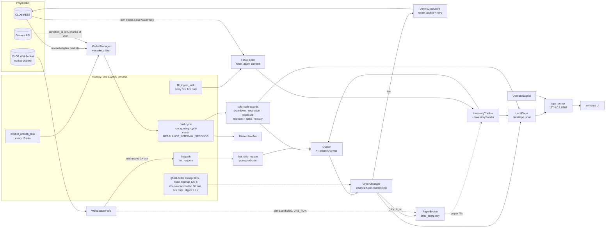

# Polymarket LP Bot

Async Python liquidity provider for Polymarket's CLOB: two-sided quotes, inventory caps, layered guards, paper mode.

## Problem

Polymarket rewards resting limit orders that sit within a per-market `max_spread` of the midpoint. As modelled in the code, an order scores `((v − s) / v)² × size` (v = `max_spread`, s = distance from mid) and the reward takes `min(Q_bid, Q_ask)`, so a one-sided book earns nothing (`core/quoter.py`, `TwoSidedQuotes.is_two_sided`). Earning it means keeping bids and asks on both outcome books of many binary markets, around the clock, inside a self-imposed API budget (token bucket, 1.5 requests/s by default, `core/client.py`).

That position carries three risks the bot has to manage:

- **Inventory.** Fills leave the wallet holding YES and NO tokens. A matched YES+NO pair redeems for $1 whatever the outcome, so only the unmatched part `|YES − NO|` is directional exposure (`core/resolution_guard.py`). Asks need inventory too: the CLOB rejects a sell of tokens the wallet does not hold, so the bot must buy tokens before it can quote both sides (`core/inventory_seeder.py`).
- **Adverse selection.** Resting quotes get filled at stale prices when the market moves.
- **Resolution.** Near resolution the mid can jump to 0 or 1 in one block and the book thins out.

**Hard constraint: no directional betting** (`AGENTS.md`). The code enforces it in four places:

- bid size is capped so the unmatched share count stays within `RESOLUTION_MAX_LOSS_USD` (`max_bid_shares`, `utils/helpers.py`), except on books whose `min_size` alone exceeds the cap (see Status and limitations);
- ask size never exceeds the tokens held, so there are no naked shorts (`Quoter._build_quote`);
- startup seeding buys the same number of YES and NO shares and checks both sides before posting either (`compute_matched_seed_n`, `core/inventory_seeder.py`);
- skew tiers and a continuous skew penalty pull quotes back toward balance, and surplus on the heavy side is sold down (`InventoryTracker.evaluate`, `InventorySeeder.rebalance_unmatched`).

## Architecture



- `main.py`: startup (fail-closed `cancel_all`, seeding, inventory sync), the cold cycle, the WebSocket hot path, background tasks, and a shutdown that cancels every open order.
- `core/market_manager.py`, `config/markets_filter.py`: reward-eligible universe from the CLOB, Gamma metadata join, hard filters and ranking, capital allocation, per-market `MarketState`.
- `core/quoter.py`, `core/toxicity_analyzer.py`: offset = ticks × volatility multiplier × toxicity multiplier, clamped to `0.499 × max_spread`; skew penalty; size caps on both sides.
- `core/order_manager.py`, `core/client.py`: smart-diff cancel/replace under a per-market `asyncio.Lock`; async facade over the synchronous SDK (`asyncio.to_thread`, token bucket, exponential backoff, non-retryable error list).
- `core/inventory.py`, `core/inventory_seeder.py`: positions and cost basis, skew tiers, exposure gates, daily drawdown breaker on realised or mark-to-mid loss, persisted state; matched seeding, flatten and rebalance.
- `core/hot_guards.py`, `core/resolution_guard.py`: skip predicate for the hot path; max-loss surplus rebalance; 24 h move and extreme-mid delisting.
- `core/ws_feed.py`, `core/fill_collector.py`: market-data stream (mid cache, 60 s staleness, reconnect with backoff); polling of the wallet's own trades with an apply-then-commit watermark.
- `core/paper_broker.py`: DRY_RUN cash, inventory and resting orders; never calls the network.
- `core/tape.py`, `utils/tape_server.py`, `core/operator_digest.py`, `terminal/`: append-only JSONL ledger, localhost FastAPI (GET-only apart from Discord channel toggles), operator UI.
- `utils/discord.py`, `core/scoring_monitor.py`, `core/rewards_tracker.py`, `backtest/`: alerts, `are_orders_scoring` checks, reward estimates, offline replay and grid search.

## Technical choices and trade-offs

**1. The hot-path guard is a pure function.** `hot_skip_reason` takes plain values and returns a reason or `None`; it does no I/O and is tested without asyncio (`core/hot_guards.py`, `tests/test_hot_guards.py`). *Why:* the WebSocket path must honour every pause the cold cycle applies, and a code audit found it did not (AUDIT.md, A1). *Cost:* it only sees what the cold cycle last published. Exposure pauses reach the hot path when `run_quoting_cycle` refreshes `_exposure_paused` (`main.py:1047`), and that wiring is not covered by the predicate's tests.

**2. Append-only tape that never raises.** Fills, posts, cancels, skips, exceptions and snapshots go to `data/tape.jsonl`, one JSON object per line; `_write` catches every error and flips `tape.ok` (`core/tape.py`, `test_write_failure_does_not_raise`). *Why:* recording must never stop quoting, and before the tape the only record was Discord and log text (AUDIT.md, A11). *Cost:* a failed write is dropped with a warning, and rotation (daily or at 16 MiB) keeps a single `.1` backup, so longer history needs `scripts/archive_tape.py`.

**3. In-process paper broker instead of a mock exchange.** With `DRY_RUN=true`, posts, cancels and seeding go to `PaperBroker`, while market data, quoting, guards and inventory run the live code. Resting orders fill when a WebSocket print or the best bid/ask reaches their limit (`core/paper_broker.py`). *Why:* it exercises the real order path with no writes to the CLOB. *Cost:* the fill model is optimistic. There is no queue position, and a BBO touch fills the whole resting size. Reward scoring is estimated rather than queried from the exchange, and DRY_RUN still needs CLOB credentials and live data.

**4. Matched seeding.** `compute_matched_seed_n` takes `N = min(ideal YES, ideal NO)`, caps it by what the pricier side can buy within the per-side budget, and floors it to whole shares. Both sides are pre-checked at the worst retry price before either is posted (`core/inventory_seeder.py`). *Why:* asks need inventory, and equal share counts keep the seed itself non-directional. *Cost:* capital sits in tokens (`SEED_BUDGET_PCT=0.65` of `TOTAL_CAPITAL` in `.env.example`), and markets whose `min_size` does not fit are skipped as `SEED_FAILED`, which stays set until the next universe refresh.

**5. Sticky delist only for terminal reasons.** `extreme_mid` (mid < 0.05 or > 0.95) and `move_24h` delists persist to `data/resolution_delist.json`. `max_loss` is never persisted; it triggers a surplus sale and the market keeps quoting (`core/resolution_guard.py`, `exit_mode_for_reason`). *Why:* delists used to flicker back after a refresh (AUDIT.md:74), but persisted `max_loss` entries "falsely skipped matched N/N preflight and caused 0/0 flatten loops" (comment in `resolution_guard.py`). *Cost:* no code path clears a terminal delist, so re-enabling a market means editing that file.

**6. Join Gamma by condition_id instead of walking its catalogue.** `MarketManager` asks Gamma only for the ids the CLOB returned as reward-eligible: 100 per request, at most 2 requests in flight, retries on 429/5xx, and a 422 splits the chunk to 50, then 20, then 1 (`core/market_manager.py`). *Why:* walking `/markets` broke twice, first on the 100-item page cap and then on offset limits (see incident 1). *Cost:* it relies on Gamma accepting repeated `condition_ids=` parameters (a comma-joined list returned nothing when probed), and any market Gamma does not return, and that has no CLOB end date, is rejected as `gamma_miss` (`config/markets_filter.py`).

## What broke and how I fixed it

**1. Boot exited with zero markets: Gamma caps pages at 100** *(live, 2026-05-19)*
- *Symptom:* startup logged "After filtering: 0 markets" and exited.
- *Root cause:* `_fetch_gamma_markets` asked for `limit=200` and stopped when a page came back short. Gamma returns at most 100 items, so the first page always looked like the last one, and the bot only ever saw the first ~100 markets.
- *Fix:* 100-item pages, stop on an empty page, a page cap with a warning, 0.7 s between pages, and tests against a fake `aiohttp` session (`d906d86`). Offset paging later returned 422 "offset too large". After a keyset-cursor attempt, the walk was replaced by the condition_id join described above (`6695287`).

**2. CLOB V2 cutover** *(external change, fixed 2026-05-09)*
- *Symptom:* Polymarket's V2 cutover retired the V1 SDK and moved collateral from USDC.e to pUSD.
- *Root cause:* an external migration. SDK calls were renamed (for example `create_or_derive_api_creds` became `create_or_derive_api_key`), the exchange contracts changed, and the wallet needed pUSD.
- *Fix:* moved the client to `py-clob-client-v2`, and the setup script to pUSD wrapping and V2 approvals (`34aa08a`). Native USDC is now swapped to USDC.e on Uniswap V3 before the wrap, with a 0.1 % minimum-out guard (`3a0887e`). Added the POA extra-data middleware to the Polygon web3 client (`4e07f59`, [TODO: the error that prompted it]). `BookParams` are now converted to dicts for the batch midpoint and order-book calls (`e4e6e26`).

**3. The seeder could leave a one-sided position** *(live session, fixed 2026-05-19)*
- *Symptom:* a seed bought YES and then skipped NO, which is a directional position the bot is not allowed to hold. Separately, the cycle log reported a positive Q-score for books that had no ask.
- *Root cause:* the cost pre-check priced only the first attempt, but retries walk the price further into the book, so the runtime cost check could abort the second side after the first had filled. The Q-score estimate also ignored the `min(Q_bid, Q_ask)` rule.
- *Fix:* both sides are pre-checked at the worst-case retry price (`SEED_AGGRESSIVE_TICKS + 2 × (attempts − 1)` ticks) and against book depth before anything is posted; sides are seeded in turn, and NO is skipped if YES got nothing. One-sided books now report Q = 0 and are tagged `ONE_SIDED` (`b48b72b`, `tests/test_seeder_atomicity.py`).

**4. Hot path re-armed paused markets; max-loss punished hedged books** *(found in code review, 2026-08-29)*
- *Symptom:* after the cold cycle paused a market for toxicity, resolution or exposure, the next WebSocket tick could post it again. The resolution guard also computed loss as `max(YES, NO)`, so a balanced 26/26 book was delisted while a 24/0 book was not (AUDIT.md, A1 and A2).
- *Root cause:* the hot path carried its own partial copy of the guard checks, and the loss formula ignored that matched pairs redeem at $1.
- *Fix:* the hot path calls `hot_skip_reason` before computing or posting anything, max loss is `|YES − NO|`, and terminal delists persist (`29907bf`, `72ef225`).

**5. Fill watermark committed before inventory was updated** *(found in code review, 2026-08-29)*
- *Symptom:* a crash between saving the trade watermark and applying the fills would have lost those fills for good. Fills were also read only once per 45 s cycle (AUDIT.md, A3 and A4).
- *Root cause:* `FillCollector.poll()` advanced and saved the watermark itself, and `main.py` applied the fills afterwards.
- *Fix:* `fetch()` has no side effects; `apply_fills` records the fills under the inventory lock and only then calls `commit()`. Polling moved to its own task every `FILL_POLL_INTERVAL_SECONDS` (`cf9edb9`, `72ef225`), and inventory now persists to `data/inventory_state.json` (`5ea1a8a`).

**6. Volatility estimate dominated backtest runtime** *(profiling, 2026-05-08)*
- *Symptom:* 26,871 backtest cycles took 71.9 s.
- *Root cause:* cProfile put 67 of 72 s in `statistics.pstdev`, which converts every float to a `Fraction` (152M `Fraction`/`as_integer_ratio` calls).
- *Fix:* `_pstdev_fast` uses `math.fsum`, and the YES and NO quotes now share one sample fetch. The same run took 9.7 s, 7.4× faster on that benchmark (`c11f962`).

## Getting started

```bash
git clone https://github.com/axsxyz/polymarket-lp-bot.git
cd polymarket-lp-bot
python3.12 -m venv .venv && source .venv/bin/activate
pip install -r requirements.txt
cp .env.example .env        # set PRIVATE_KEY; DRY_RUN=true is the default
python main.py
```

- `DRY_RUN=true` posts no orders. Orders, cancels and seeding go to the in-process paper broker, which starts with `TOTAL_CAPITAL` in paper cash (or `PAPER_CASH` if set).
- DRY_RUN still talks to Polymarket. Startup derives CLOB API credentials from `PRIVATE_KEY` and reads live markets and the market WebSocket, so it needs network access and a valid key. [TODO: confirm an unfunded key is enough for DRY_RUN.]
- The operator terminal is at `http://127.0.0.1:8765/` (`TAPE_HTTP_ENABLED`, `TAPE_HTTP_PORT`).
- Live mode (`DRY_RUN=false`) needs a funded wallet with pUSD and on-chain approvals (`python scripts/setup_allowances.py --all`). For the full runbook, scripts and deployment, see [docs/operations.md](docs/operations.md).

## Configuration

| Variable | `.env.example` | Meaning (`config/settings.py`) |
|---|---|---|
| `PRIVATE_KEY` | placeholder | EOA key; signs orders and derives CLOB API credentials |
| `DRY_RUN` | `true` | Paper mode: orders go to the in-process paper broker |
| `TOTAL_CAPITAL` | `10000` | Capital budget; base for drawdown limit, seed budget and paper cash |
| `MAX_CAPITAL_PER_MARKET` | `500` | Per-market allocation cap |
| `MAX_MARKETS` | `20`¹ | Markets selected per refresh |
| `REBALANCE_INTERVAL_SECONDS` | `45`¹ | Cold-cycle period, with ±2 s jitter |
| `QUOTE_OFFSET_TICKS` | `1` | Base distance from mid in ticks, scaled by volatility and toxicity |
| `WS_ENABLED` | `true` | Event-driven requotes from the market WebSocket |
| `API_RATE_LIMIT_RPS` / `_BURST` | `1.5` / `20` | Token bucket in front of every CLOB call |
| `FILL_POLL_INTERVAL_SECONDS` | `3` | Polling period for the wallet's own trades (live) |
| `DAILY_DRAWDOWN_LIMIT_PCT` | `0.05` | Pause until UTC midnight if realised or mark-to-mid loss exceeds this × `TOTAL_CAPITAL` |
| `SEED_BUDGET_PCT` | `0.65` | Share of `TOTAL_CAPITAL` for seed inventory; the rest stays as bid cash |
| `RESOLUTION_MAX_LOSS_USD` / `RESOLUTION_MAX_MOVE_24H_PCT` | `25.0` / `15.0` | Max unmatched (YES minus NO) shares per market, valued at $1 each; max 24 h relative mid move before delisting |
| `TAPE_HTTP_ENABLED` / `TAPE_HTTP_PORT` | `true` / `8765` | Localhost tape API and operator terminal |
| `DISCORD_WEBHOOK_URL` / `DISCORD_CHANNELS` | placeholder / all kinds | Alert webhook and allowlist of alert kinds |

¹ If the variable is unset, `config/settings.py` falls back to a different value: `REBALANCE_INTERVAL_SECONDS=15`, `MAX_MARKETS=60` (and `MIN_MARKETS=1` against `3` in `.env.example`).

Full list: `.env.example`.

## Tests

```bash
python -m pytest
```

The suite has 416 tests in 25 modules and passes offline in about 7 s.

- **Quoting** (70): `test_quoter`, `test_quote_two_sided`, `test_helpers`
- **Inventory, seeding and PnL** (67): `test_inventory`, `test_seeder_atomicity`, `test_maxloss_rebalance`, `test_pnl_basis`, `test_pnl_topup`
- **Risk guards** (93): `test_resolution_guard`, `test_toxicity_analyzer`, `test_hot_guards`, `test_market_exposure`
- **Market selection** (44): `test_markets_filter`, `test_market_states`, `test_gamma_pagination`
- **Exchange I/O and paper mode** (25): `test_paper_broker`, `test_order_manager`, `test_ws_feed`, `test_fill_collector`
- **Observability** (27): `test_tape`, `test_discord`, `test_rewards_tracker`
- **Backtest** (90): `test_fetcher`, `test_metrics`, `test_simulator`

## Development workflow

- The repo was built with coding agents, and their scaffolding is checked in. `AGENTS.md`, `CLAUDE.md` and `.cursor/rules/*.mdc` hold the architecture map and hard rules: search and read before writing, don't reference modules that don't exist, don't invent env vars outside `config/settings.py`, and don't flip `DRY_RUN` without the owner's confirmation.
- `memory-bank/lp-bot.md` (in French) is the running log agents read at the start of a session and append to at the end. `scripts/post-commit.sh` prints a reminder to update it.
- An earlier LLM-written audit is archived in `docs/archives/`. `AUDIT.md` came from PR #1, written by a Cursor agent: it re-checked that audit against the code and listed issues A1–A12, which are now marked fixed or won't-fix. 32 commits carry a Cursor co-author trailer.
- The agent docs lag the code in places. For example, they describe `main.py` as about 1,000 lines; it is about 2,050.

## Status and limitations

Implemented: everything above. Every audit item from A1 to A12 is closed (AUDIT.md:305-322). In `ROADMAP.md`, 23 of 24 tasks are marked done, but that file has not changed since the initial commit, so its checklist lags the work.

Still open in `ROADMAP.md`:
- P5-5, graduated live validation, along with all three staged capital gates.
- Three pre-go-live checks: a DRY_RUN run with zero phantom fills, cycles finishing within the interval, and no 429s over a one-hour run.

Known limitations:
- The wallet's own fills arrive by REST polling every 3 s. The SDK has no user-channel WebSocket, so that item is won't-fix (AUDIT.md:307, 313).
- The toxicity signals (VPIN and fill-vs-mid) are fed live but have not yet been shown to fire in production (AUDIT.md:316).
- LP reward income is an estimate: pool × `LP_ESTIMATED_SHARE` (0.10 by default), not a measured share (AUDIT.md:264).
- The backtest is only good for ranking parameter sets. Its absolute PnL is biased by a naive fill model (`8675861`), and paper-mode fills are optimistic (trade-off 3).
- Strategy risk the code cannot remove: 1-tick resting quotes are exposed to faster traders, and long-dated markets lock inventory until it is sold or the market resolves (AUDIT.md:265-266).
- Books whose `min_size` exceeds `RESOLUTION_MAX_LOSS_USD` still post `min_size` bids on both sides and are tagged `bid_over_cap` (`core/quoter.py:403-416`).
- There is no CI, linter or type checker (AGENTS.md:33), and `main.py` is a single ~2,050-line orchestrator.
- Live results: [TODO: markets run live, uptime, fills and volume, rewards earned, net PnL, measured requote latency].

## License

MIT, see [LICENSE](LICENSE).
